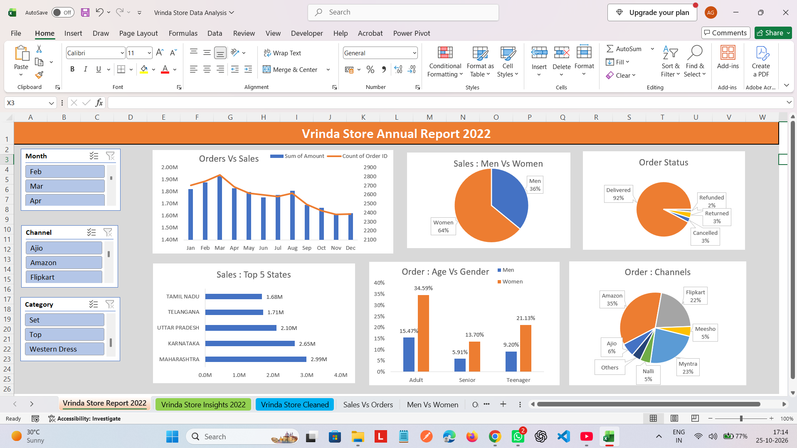

# Vrinda Store Data Analysis – 2022

An Excel-based sales analysis project exploring Vrinda Store's 2022 order data. The workbook includes a sales dashboard, cleaned data, and insight summaries to help understand customer segments, sales channels, order status, and regional performance.

## Project Overview

This project uses Microsoft Excel to turn raw order-level data into a visual sales report. Interactive dashboard filters help users explore results by month, sales channel, and product category.

## Screenshots

## Tools and Skills

- Microsoft Excel
- Data cleaning and preparation
- PivotTables and PivotCharts
- Interactive slicers and dashboard design
- Sales and order trend analysis
- Customer segmentation by gender and age group
- Regional and sales-channel analysis
- Business insights and recommendations

## How to Use

1. Download or clone this repository.
2. Open the Excel workbook in Microsoft Excel.
3. Open the **Vrinda Store Report 2022** sheet to explore the dashboard.
4. Use the slicers for **Month**, **Channel**, and **Category** to filter the dashboard.
5. Review **Vrinda Store Insights 2022** for findings and suggested actions.
6. Explore the supporting analysis sheets for additional breakdowns.

## Author

**Ankit Gangwar**  
[github.com/ankitgangwar0012](https://github.com/ankitgangwar0012)

